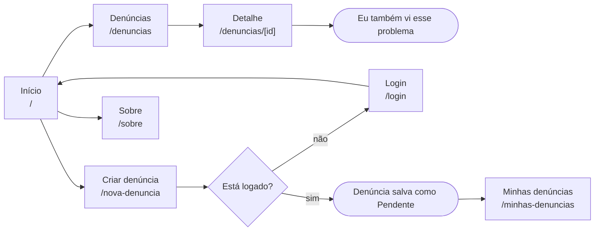
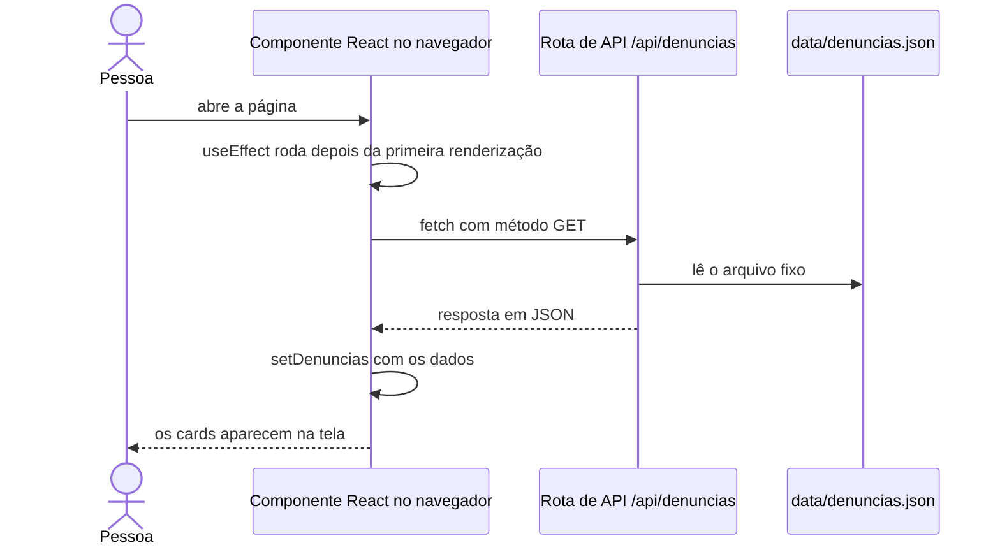
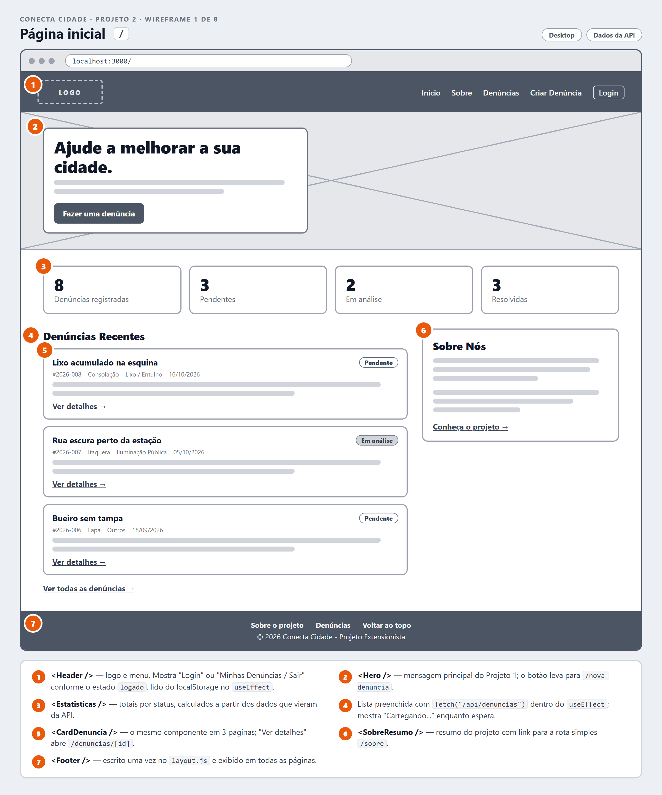
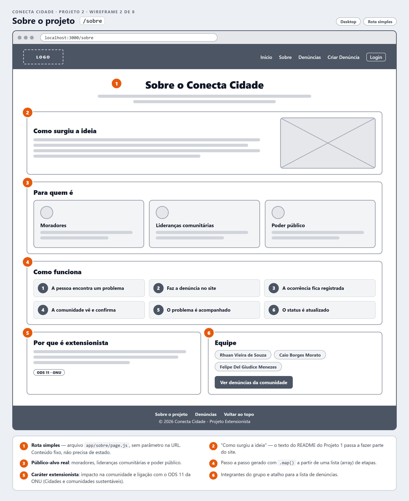
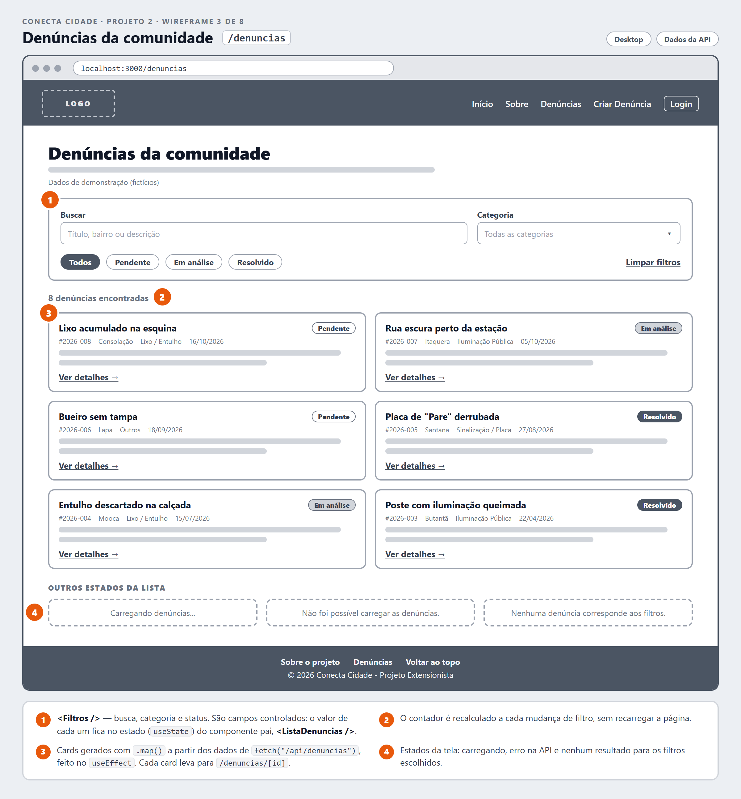
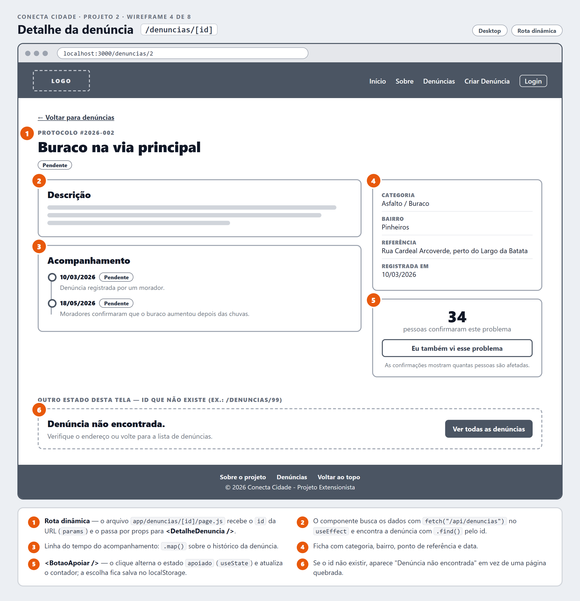
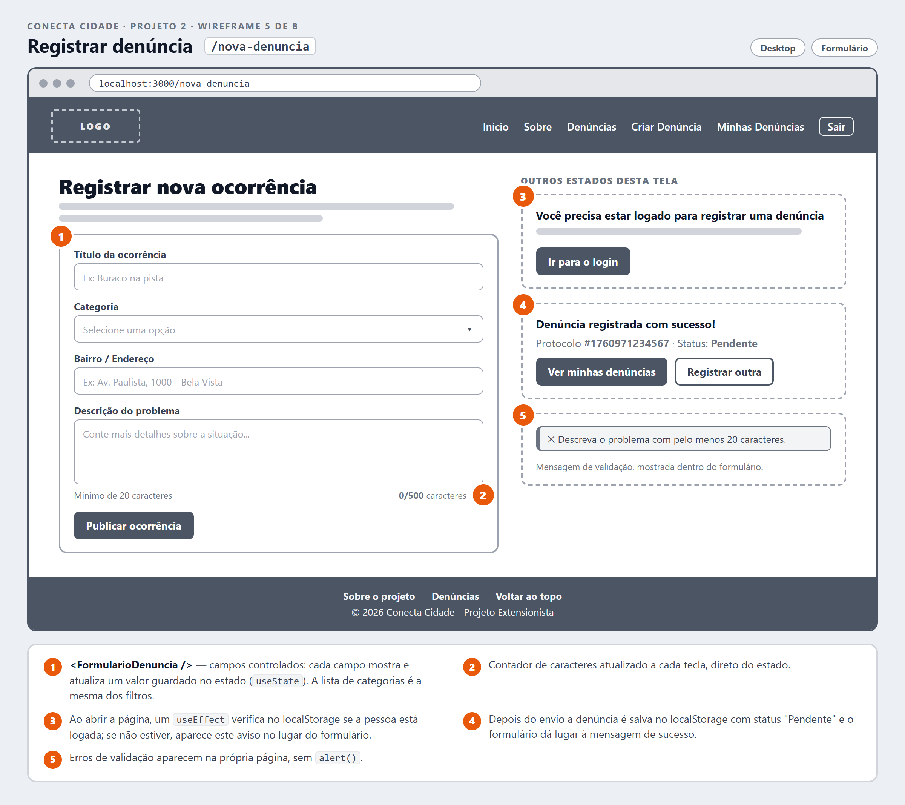
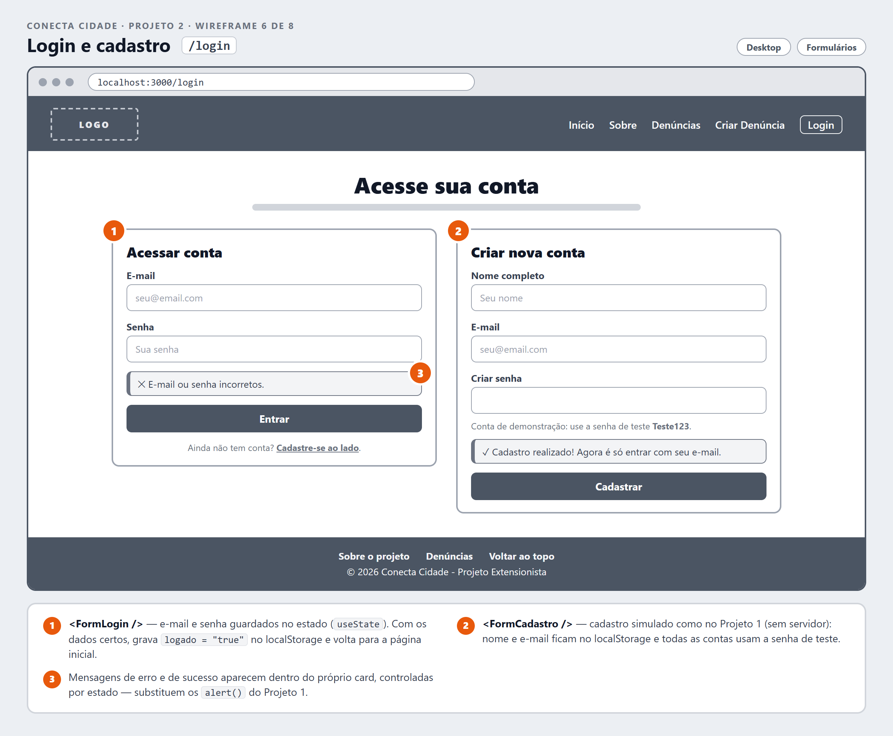
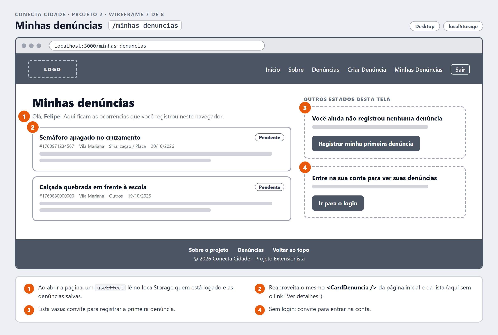
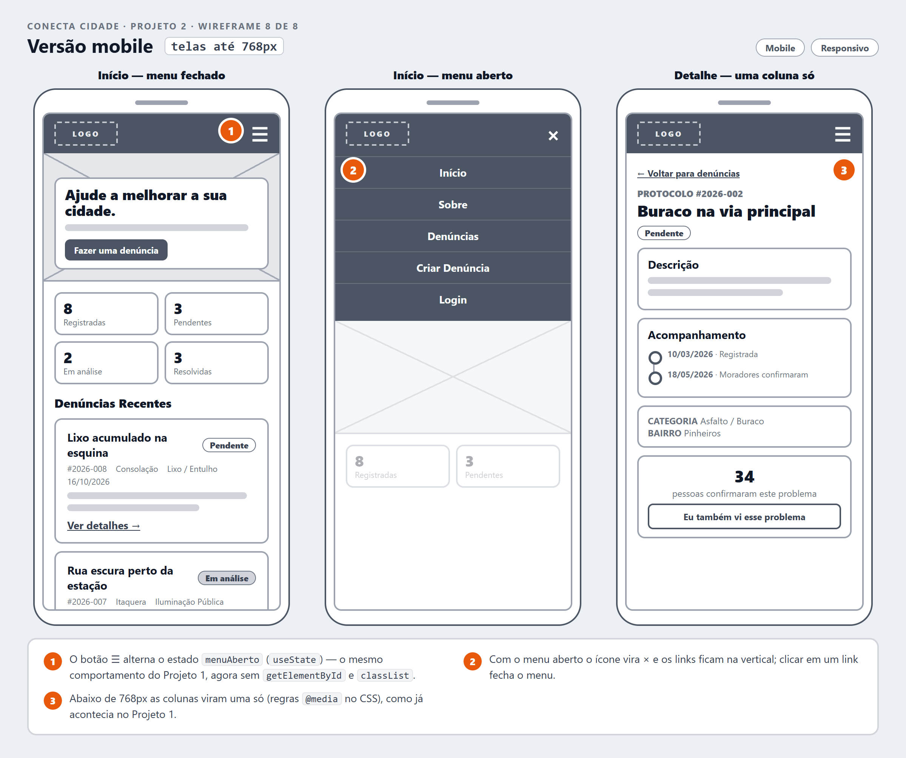

# Conecta Cidade 🦋 Projeto 2: Borboleta

**Migração do site do Projeto 1 para componentes React com Next.js**, mantendo o caráter extensionista: um site para que moradores de São Paulo registrem e acompanhem os problemas urbanos do seu bairro.

| Integrante | RA |
|---|---|
| Rhuan Vieira de Souza | 10755828 |
| Caio Borges Morato | 10437025 |
| Felipe Del Giudice Menezes | 10726771 |

Projeto 1 (HTML, CSS e JavaScript): [github.com/rhuanvieiraa/Projeto_Web_Mobile](https://github.com/rhuanvieiraa/Projeto_Web_Mobile)

## Andamento do projeto

| Check-in | O que é entregue | Situação |
|---|---|---|
| **1** | **Ideação e protótipo** | ✅ Este documento |
| 2 | Estrutura inicial em Next.js e migração do HTML e do CSS geral | ⏳ Próxima etapa |
| 3 | Conversão para componentes React e interatividade básica | ⏳ |
| 4 | Rotas simples e dinâmicas | ⏳ |
| 5 | Rota de API com JSON fixo e consumo via GET | ⏳ |
| Final | Projeto completo, tutorial finalizado e código zipado no Moodle | ⏳ |

> Este README é o **tutorial do projeto** e vai crescer a cada check-in. Nesta primeira entrega ele traz a **ideação** e o **protótipo**. As seções "Como rodar", "Trechos de código comentados" (incluindo a rota de API) e "Aprendizados" entram conforme o código for construído.

## Sumário

1. [O ponto de partida: o Projeto 1](#1-o-ponto-de-partida-o-projeto-1)
2. [Explicação extensionista](#2-explicação-extensionista)
3. [Processo de ideação](#3-processo-de-ideação)
4. [Protótipo em wireframe](#4-protótipo-em-wireframe)
5. [Por que migrar para componentes React](#5-por-que-migrar-para-componentes-react)
6. [Próximas etapas](#6-próximas-etapas)
7. [Uso de Inteligência Artificial](#7-uso-de-inteligência-artificial)
8. [Fontes](#8-fontes)

---

## 1. O ponto de partida: o Projeto 1

No Projeto 1 criamos o **Conecta Cidade**, um site de ajuda urbana para a cidade de São Paulo. A ideia surgiu dos problemas que encontramos todos os dias: buraco na rua, poste apagado, lixo acumulado, calçada quebrada. Esses problemas podem ficar semanas ou meses sem solução, porque é difícil para o poder público saber o que acontece em cada rua de uma cidade tão grande.

O site do Projeto 1 tinha quatro páginas (`index.html`, `denuncia.html`, `minhas-denuncias.html` e `login.html`), um `style.css` e um `script.js`. Com ele era possível:

- registrar uma denúncia com título, categoria, bairro/endereço e descrição;
- ver algumas denúncias recentes;
- fazer cadastro e login simulados, usando o `localStorage`;
- ver as denúncias registradas no próprio navegador.

**No Projeto 2 o site continua o mesmo (mesma causa, mesmo público, mesma identidade visual), mas reconstruído com React e Next.js.** O fluxo principal também continua o do Projeto 1:

> Pessoa encontra um problema → faz a denúncia no site → a ocorrência fica registrada → outras pessoas visualizam → o problema é acompanhado → a situação é atualizada.

---

## 2. Explicação extensionista

### O problema real

São Paulo já tem um canal oficial para pedir serviços à prefeitura, o **SP156** (portal, aplicativo e telefone 156), que recebe pedidos como tapa-buraco, iluminação pública e poda de árvores. Segundo a própria prefeitura, cada solicitação tem um prazo de resposta que pode variar de **5 a 60 dias**, dependendo do tipo de serviço ([fonte 1](#8-fontes)).

O Conecta Cidade **não substitui** esse canal. A proposta é complementar: dar **visibilidade coletiva** aos problemas do bairro. Qualquer morador consegue ver o que já foi registrado, confirmar que o problema continua lá e acompanhar se ele foi resolvido.

### Público-alvo

| Quem | O que precisa | Como o site atende |
|---|---|---|
| **Moradores**: pedestres, ciclistas, motoristas e quem usa ônibus e metrô | Registrar um problema rápido, pelo celular | Formulário curto e layout pensado primeiro para o celular |
| **Lideranças comunitárias e associações de moradores** | Reunir as demandas da região e cobrar soluções | Lista com filtros por status e categoria; protocolo e histórico de cada caso |
| **Poder público**: subprefeituras e equipes de zeladoria | Saber onde estão os problemas e quantas pessoas são afetadas | Denúncias organizadas por bairro e categoria, com o número de confirmações |

### Personas

Para não perder de vista quem vai usar o site, criamos três personas. Elas são fictícias, mas baseadas em situações comuns do dia a dia da cidade.

| Persona | Situação | O que precisa | O que isso mudou no projeto |
|---|---|---|---|
| **Dona Marta**, 62 anos, Butantã | Aposentada, usa o celular principalmente para o WhatsApp. Volta do ponto de ônibus à noite por uma rua com poste apagado. | Poucos passos, letras legíveis e botões grandes | Layout mobile, formulário curto e mensagens claras na própria tela |
| **Lucas**, 24 anos, Pinheiros | Entregador de bicicleta; buraco na via é risco todos os dias. | Saber se alguém já denunciou antes de registrar de novo | Busca na lista e botão "Eu também vi esse problema" |
| **Sr. Antônio**, 55 anos, Mooca | Participa da associação de moradores e leva as demandas do bairro à subprefeitura. | Organizar as denúncias e acompanhar cada caso | Filtros por status e categoria e página de detalhe com protocolo e linha do tempo |

### Impacto esperado na comunidade

- **Visibilidade:** o problema deixa de ser de uma pessoa só e passa a ser visto pelo bairro inteiro.
- **Menos denúncias repetidas:** em vez de registrar de novo, a pessoa confirma o problema, e o número de confirmações mostra quantas pessoas são afetadas.
- **Transparência no acompanhamento:** cada denúncia tem protocolo, status (Pendente, Em análise ou Resolvido) e uma linha do tempo.
- **Informação organizada** para as associações de moradores e para o poder público.
- **Participação cidadã:** aproximar a comunidade do poder público, o mesmo objetivo do Projeto 1.

O projeto se conecta ao **Objetivo de Desenvolvimento Sustentável 11 da ONU (Cidades e comunidades sustentáveis)**, que busca *"tornar as cidades e os assentamentos humanos inclusivos, seguros, resilientes e sustentáveis"* ([fonte 2](#8-fontes)).

---

## 3. Processo de ideação

A ideação seguiu cinco passos:

1. **Revisitar o Projeto 1:** reler o código e listar o que funcionava e o que atrapalhava (3.1).
2. **Voltar ao público:** definir o público-alvo e as personas (seção 2).
3. **Gerar e priorizar ideias:** listar tudo o que poderia entrar e decidir o que cabe no Projeto 2 (3.2).
4. **Planejar:** desenhar o fluxo do usuário, as rotas, os componentes e a rota de API (3.3 a 3.7).
5. **Prototipar:** desenhar os wireframes de cada página (seção 4).

### 3.1 Diagnóstico do Projeto 1

Antes de pensar em telas novas, relemos o código do Projeto 1. Cada problema encontrado virou um motivo concreto para a migração:

| O que encontramos no Projeto 1 | Por que atrapalha | Como o React e o Next.js resolvem |
|---|---|---|
| Cabeçalho e rodapé copiados nos 4 arquivos HTML | Toda mudança precisa ser feita 4 vezes, e as cópias já divergiram: o título de `denuncia.html` está como "**Coneta** Cidade" e o `login.html` ficou sem a tag `<body>` | `<Header />` e `<Footer />` escritos uma vez só, no `layout.js` |
| Denúncias "recentes" escritas direto no HTML | A página inicial mostra sempre as mesmas duas denúncias | Dados em um arquivo JSON, entregues por uma rota de API e desenhados com `.map()` |
| O card de denúncia é montado com 9 chamadas de `document.createElement` no `script.js`, além das versões escritas à mão no HTML | A mesma interface escrita de dois jeitos diferentes | Um componente `<CardDenuncia />` reutilizado em 3 páginas |
| Dois formulários de denúncia diferentes (`index.html` e `denuncia.html`) | As opções divergem: só um tem "Sinalização / Placa". Em `denuncia.html` a opção "Selecione" tem valor `" "` (um espaço), e por isso o `required` aceita o envio sem categoria | Um único `<FormularioDenuncia />` e uma lista de categorias compartilhada |
| Um único `script.js` para todas as páginas, cheio de `if (formulario)` | A lógica de páginas diferentes fica misturada | Cada componente cuida da própria lógica com `useState` e `useEffect` |
| As classes `status-pendente` e `status-resolvido` aparecem no HTML, mas não existem no CSS | O status não tem destaque visual | Componente `<StatusBadge />` com uma cor para cada status |
| Avisos com `alert()` | Interrompem o uso e não combinam com o visual do site | Mensagens dentro da própria página, controladas por estado |
| Não existe página para ver uma denúncia específica | O slogan é "Denuncie. Acompanhe.", mas não dá para acompanhar um caso | Rota dinâmica `/denuncias/[id]` com linha do tempo |
| O link "Contato" do rodapé aponta para `#contato`, que não existe | Link quebrado | Rodapé revisado, só com links que funcionam |

### 3.2 Brainstorm e priorização

Listamos todas as ideias que surgiram e classificamos cada uma:

| Ideia | Decisão | Por quê |
|---|---|---|
| Migrar todas as páginas do Projeto 1 para componentes React | ✅ Essencial | Requisito do Projeto 2 |
| Página `/sobre` com a explicação extensionista | ✅ Essencial | Rota simples (sem parâmetro) |
| Página de detalhe `/denuncias/[id]` com linha do tempo | ✅ Essencial | Rota dinâmica (com parâmetro) e o "Acompanhe" do slogan |
| Lista pública de denúncias com dados vindos de uma rota de API | ✅ Essencial | Rota de API com JSON fixo e `fetch` no cliente com `useEffect` |
| Filtros por status, categoria e busca | ✅ Importante | Persona Sr. Antônio; usa `useState` |
| Números da comunidade na página inicial | ✅ Importante | Mostra o impacto de forma rápida |
| Botão "Eu também vi esse problema" | ✅ Importante | Persona Lucas; evita denúncias repetidas |
| Mensagens na tela no lugar de `alert()` | ✅ Importante | Persona Dona Marta; experiência mais clara |
| Deploy na Vercel | 🔸 Se der tempo | Opcional no enunciado |
| Mapa com as ocorrências | ❌ Fora do escopo | Exigiria uma biblioteca de mapas e coordenadas |
| Envio de fotos | ❌ Fora do escopo | Sem servidor não há onde guardar os arquivos. No Projeto 1 o campo existia, mas a foto não era salva; preferimos tirar o campo a manter algo que não funciona |
| Login real e banco de dados | ❌ Fora do escopo | O login continua simulado com `localStorage`, como no Projeto 1 |
| Integração com o SP156 | ❌ Fora do escopo | Dependeria de acesso aos sistemas da prefeitura |
| Context API, Tailwind ou CSS-in-JS | ❌ Não usar | Fora das escolhas técnicas da disciplina: estado só com `useState`/`useEffect`; estilos com CSS Modules e `styles/globals.css` |

### 3.3 Fluxo do usuário



### 3.4 Mapa de rotas

| Rota | Arquivo (App Router) | Tipo | O que mostra | Origem no Projeto 1 |
|---|---|---|---|---|
| `/` | `app/page.js` | Página | Apresentação, números da comunidade e denúncias recentes | `index.html` |
| `/sobre` | `app/sobre/page.js` | **Rota simples (sem parâmetro)** | Explicação extensionista, público-alvo e equipe | Nova |
| `/denuncias` | `app/denuncias/page.js` | Página | Lista da comunidade com filtros | Nova |
| `/denuncias/[id]` | `app/denuncias/[id]/page.js` | **Rota dinâmica (com parâmetro)** | Detalhe, linha do tempo e confirmações | Nova |
| `/nova-denuncia` | `app/nova-denuncia/page.js` | Página | Formulário de denúncia | `denuncia.html` + formulário do `index.html` |
| `/minhas-denuncias` | `app/minhas-denuncias/page.js` | Página | Denúncias registradas pela pessoa | `minhas-denuncias.html` |
| `/login` | `app/login/page.js` | Página | Login e cadastro simulados | `login.html` |
| `/api/denuncias` | `app/api/denuncias/route.js` | **Rota de API (GET)** | Devolve o JSON fixo de denúncias | Nova |

### 3.5 Plano de componentes

```text
app/layout.js
├── Header                 menu mobile e estado de login
├── (página atual)
└── Footer

/  (Início)
├── Hero
└── PainelInicio           busca os dados na API
    ├── Estatisticas
    ├── CardDenuncia ×3
    │   └── StatusBadge
    └── SobreResumo

/denuncias
└── ListaDenuncias         busca os dados na API e guarda os filtros
    ├── Filtros
    └── CardDenuncia ×N

/denuncias/[id]
└── DetalheDenuncia        busca os dados e encontra a denúncia pelo id
    ├── StatusBadge
    └── BotaoApoiar

/nova-denuncia     → FormularioDenuncia
/minhas-denuncias  → MinhasDenuncias → CardDenuncia
/login             → FormLogin + FormCadastro
```

| Componente | Responsabilidade | Estado (`useState`) | Efeito (`useEffect`) | Usado em |
|---|---|---|---|---|
| `Header` | Logo e menu de navegação | `menuAberto`, `logado` | Lê o login salvo no `localStorage` | Todas as páginas (layout) |
| `Footer` | Links e créditos | — | — | Todas as páginas (layout) |
| `Hero` | Chamada principal | — | — | `/` |
| `PainelInicio` | Números da comunidade e denúncias recentes | `denuncias`, `carregando`, `erro` | `fetch("/api/denuncias")` | `/` |
| `Estatisticas` | Totais por status | — (recebe por props) | — | `/` |
| `CardDenuncia` | Resumo de uma denúncia | — (recebe por props) | — | `/`, `/denuncias`, `/minhas-denuncias` |
| `StatusBadge` | Etiqueta colorida do status | — | — | Cards e detalhe |
| `SobreResumo` | Resumo do projeto e link para `/sobre` | — | — | `/` |
| `ListaDenuncias` | Lista completa e aplicação dos filtros | `denuncias`, `filtros`, `carregando`, `erro` | `fetch("/api/denuncias")` | `/denuncias` |
| `Filtros` | Busca, categoria e status | — (recebe do pai por props) | — | `/denuncias` |
| `DetalheDenuncia` | Detalhe e linha do tempo | `denuncia`, `carregando`, `erro` | `fetch` e `.find()` pelo id | `/denuncias/[id]` |
| `BotaoApoiar` | "Eu também vi esse problema" | `apoiado` | Lê o apoio salvo no `localStorage` | `/denuncias/[id]` |
| `FormularioDenuncia` | Registrar uma denúncia | `campos`, `logado`, `erro`, `protocolo` | Verifica se a pessoa está logada | `/nova-denuncia` |
| `MinhasDenuncias` | Denúncias da pessoa logada | `usuario`, `denuncias` | Lê o `localStorage` | `/minhas-denuncias` |
| `FormLogin` / `FormCadastro` | Login e cadastro simulados | Campos e mensagens | — | `/login` |

**Estilos:** `styles/globals.css` com as variáveis de cor, os formulários e os botões que vêm do `style.css` do Projeto 1, e um arquivo `.module.css` para cada componente (CSS Modules).

### 3.6 Plano da rota de API

O enunciado pede uma rota de API dentro do próprio Next.js, que devolva um JSON fixo e seja consumida no cliente. O plano:

1. **`data/denuncias.json`:** arquivo com as denúncias de exemplo (dados fictícios, só para demonstração). Cada denúncia terá este formato:

   ```json
   {
     "id": 2,
     "protocolo": "2026-002",
     "titulo": "Buraco na via principal",
     "categoria": "asfalto",
     "bairro": "Pinheiros",
     "referencia": "Rua Cardeal Arcoverde, trecho perto do Largo da Batata",
     "descricao": "Existe um buraco na pista da direita provocando risco aos motoristas e ciclistas.",
     "data": "2026-03-10",
     "status": "Pendente",
     "apoios": 34,
     "historico": [
       { "data": "2026-03-10", "status": "Pendente", "descricao": "Denúncia registrada por um morador." }
     ]
   }
   ```

2. **`app/api/denuncias/route.js`:** rota com uma função `GET` que devolve esse JSON.
3. **Consumo no cliente:** `PainelInicio`, `ListaDenuncias` e `DetalheDenuncia` chamam `fetch("/api/denuncias")` dentro de um `useEffect` e guardam a resposta com `useState`.



### 3.7 Estrutura de pastas planejada

```text
conecta-cidade-next/
├── app/
│   ├── layout.js                  Header e Footer em todas as páginas
│   ├── page.js                    /
│   ├── sobre/page.js              /sobre  (rota simples)
│   ├── denuncias/page.js          /denuncias
│   ├── denuncias/[id]/page.js     /denuncias/[id]  (rota dinâmica)
│   ├── nova-denuncia/page.js      /nova-denuncia
│   ├── minhas-denuncias/page.js   /minhas-denuncias
│   ├── login/page.js              /login
│   └── api/denuncias/route.js     GET /api/denuncias
├── components/                    um .jsx e um .module.css por componente
├── data/denuncias.json            JSON fixo (mockado)
├── styles/globals.css             estilos gerais vindos do style.css
├── public/imagens/                logo e imagens do Projeto 1
└── docs/wireframes/               imagens do protótipo
```

---

## 4. Protótipo em wireframe

Os wireframes são de **baixa fidelidade**: tons de cinza, sem as cores finais, para focar na estrutura e no comportamento de cada página. Os **números em laranja** marcam os componentes e as interações, explicados na legenda de cada imagem. Os textos de exemplo vêm das denúncias fictícias planejadas para o JSON.

### 4.1 Página inicial `/`



1. **`<Header />`:** logo e menu. Mostra "Login" ou "Minhas Denúncias / Sair" conforme o estado `logado`, lido do `localStorage` no `useEffect`.
2. **`<Hero />`:** a mensagem principal do Projeto 1; o botão leva para `/nova-denuncia`.
3. **`<Estatisticas />`:** totais por status, calculados com os dados que vieram da API.
4. Lista preenchida com `fetch("/api/denuncias")` dentro do `useEffect`; mostra "Carregando..." enquanto espera.
5. **`<CardDenuncia />`:** o mesmo componente em 3 páginas; "Ver detalhes" abre `/denuncias/[id]`.
6. **`<SobreResumo />`:** resumo do projeto com link para a rota simples `/sobre`.
7. **`<Footer />`:** escrito uma vez no `layout.js` e exibido em todas as páginas.

### 4.2 Sobre `/sobre` (rota simples)



1. **Rota simples:** arquivo `app/sobre/page.js`, sem parâmetro na URL. Conteúdo fixo, não precisa de estado.
2. "Como surgiu a ideia": o texto do README do Projeto 1 passa a fazer parte do site.
3. **Público-alvo real:** moradores, lideranças comunitárias e poder público.
4. Passo a passo gerado com `.map()` a partir de uma lista (array) de etapas.
5. **Caráter extensionista:** impacto na comunidade e ligação com o ODS 11 da ONU.
6. Integrantes do grupo e atalho para a lista de denúncias.

### 4.3 Denúncias da comunidade `/denuncias`



1. **`<Filtros />`:** busca, categoria e status. São campos controlados: o valor de cada um fica no estado (`useState`) do componente pai, `<ListaDenuncias />`.
2. O contador é recalculado a cada mudança de filtro, sem recarregar a página.
3. Cards gerados com `.map()` a partir dos dados de `fetch("/api/denuncias")`, feito no `useEffect`. Cada card leva para `/denuncias/[id]`.
4. Estados da tela: carregando, erro na API e nenhum resultado para os filtros escolhidos.

### 4.4 Detalhe da denúncia `/denuncias/[id]` (rota dinâmica)



1. **Rota dinâmica:** o arquivo `app/denuncias/[id]/page.js` recebe o `id` da URL (`params`) e o passa por props para `<DetalheDenuncia />`.
2. O componente busca os dados com `fetch("/api/denuncias")` no `useEffect` e encontra a denúncia com `.find()` pelo id.
3. Linha do tempo do acompanhamento: `.map()` sobre o histórico da denúncia.
4. Ficha com categoria, bairro, ponto de referência e data.
5. **`<BotaoApoiar />`:** o clique alterna o estado `apoiado` (`useState`) e atualiza o contador; a escolha fica salva no `localStorage`.
6. Se o id não existir, aparece "Denúncia não encontrada" em vez de uma página quebrada.

### 4.5 Registrar denúncia `/nova-denuncia`



1. **`<FormularioDenuncia />`:** campos controlados; cada campo mostra e atualiza um valor guardado no estado (`useState`). A lista de categorias é a mesma dos filtros.
2. Contador de caracteres atualizado a cada tecla, direto do estado.
3. Ao abrir a página, um `useEffect` verifica no `localStorage` se a pessoa está logada; se não estiver, aparece um aviso no lugar do formulário.
4. Depois do envio, a denúncia é salva no `localStorage` com status "Pendente" e o formulário dá lugar à mensagem de sucesso.
5. Erros de validação aparecem na própria página, sem `alert()`.

### 4.6 Login e cadastro `/login`



1. **`<FormLogin />`:** e-mail e senha guardados no estado (`useState`). Com os dados certos, grava `logado = "true"` no `localStorage` e volta para a página inicial.
2. **`<FormCadastro />`:** cadastro simulado como no Projeto 1 (sem servidor). Nome e e-mail ficam no `localStorage` e todas as contas usam a senha de teste.
3. Mensagens de erro e de sucesso aparecem dentro do próprio card, controladas por estado, e substituem os `alert()` do Projeto 1.

### 4.7 Minhas denúncias `/minhas-denuncias`



1. Ao abrir a página, um `useEffect` lê no `localStorage` quem está logado e as denúncias salvas.
2. Reaproveita o mesmo `<CardDenuncia />` da página inicial e da lista (aqui sem o link "Ver detalhes").
3. Lista vazia: convite para registrar a primeira denúncia.
4. Sem login: convite para entrar na conta.

### 4.8 Versão mobile



1. O botão ☰ alterna o estado `menuAberto` (`useState`). É o mesmo comportamento do Projeto 1, agora sem `getElementById` e `classList`.
2. Com o menu aberto, o ícone vira × e os links ficam na vertical; clicar em um link fecha o menu.
3. Abaixo de 768px as colunas viram uma só (regras `@media` no CSS), como já acontecia no Projeto 1.

### 4.9 Decisões de design

- **Mesma identidade visual do Projeto 1:** azul-escuro `#0b2f55` no cabeçalho e no rodapé, azul `#0e5aa7` em botões e links, amarelo `#f4b400` nos detalhes, fundo azul-claro `#eaf3fb` e a mesma logo.
- **Status com cor e com texto:** Pendente (amarelo), Em análise (azul) e Resolvido (verde). O nome do status sempre aparece escrito, para não depender só da cor.
- **Celular primeiro:** abaixo de 768px tudo vira uma coluna e o menu vira ☰, como no Projeto 1.
- **Formulários curtos** com rótulos sempre visíveis e mensagens na própria tela.
- **Estados previstos desde o protótipo:** carregando, erro, lista vazia e "não encontrado" foram desenhados antes do código, para nenhuma tela ficar em branco.

---

## 5. Por que migrar para componentes React

1. **Escrever uma vez e usar em vários lugares:** `<Header />`, `<Footer />` e `<CardDenuncia />` deixam de ser copiados entre arquivos.
2. **Manutenção mais segura:** corrigir um componente corrige todas as páginas que o usam. Com um único `<Header />`, o "Coneta Cidade" de `denuncia.html` não teria acontecido.
3. **A interface acompanha os dados:** em vez de criar elementos um a um com `createElement`, descrevemos como a tela deve ficar. Quando o estado muda, o React atualiza a tela sozinho.
4. **Estado organizado:** o `useState` guarda o que muda na tela (menu aberto, filtros, campos do formulário); o `useEffect` cuida do que acontece depois que a página aparece (buscar dados na API, ler o `localStorage`).
5. **Dados separados da interface:** as denúncias saem do HTML e passam a vir de uma rota de API. Para usar um banco de dados no futuro, basta mudar o que a rota devolve; os componentes continuam iguais.
6. **Rotas pelo próprio Next.js:** cada pasta dentro de `app/` vira uma página, e a rota dinâmica `[id]` cria uma página para cada denúncia sem escrever um HTML para cada uma.
7. **Navegação mais rápida:** o `<Link>` do Next.js troca de página sem recarregar o site inteiro.
8. **Trabalho em grupo:** cada integrante pode cuidar de componentes diferentes, com menos conflito no mesmo arquivo.

**Antes e depois.** No Projeto 1, cada card de denúncia criado pelo JavaScript era montado assim (trecho real do `script.js`):

```js
const card = document.createElement("article");
card.className = "card-denuncia";

const titulo = document.createElement("h3");
titulo.textContent = denuncia.titulo;
card.appendChild(titulo);

const protocolo = document.createElement("p");
protocolo.textContent = "Protocolo: #" + denuncia.protocolo;
card.appendChild(protocolo);

// ...e mais 6 blocos iguais para autor, data, categoria, bairro, status e descrição

listaDenuncias.appendChild(card);
```

No Projeto 2, o plano é que o card vire um componente que recebe a denúncia por props:

```jsx
// O componente descreve COMO um card deve ficar, para qualquer denúncia
function CardDenuncia({ denuncia }) {
  return (
    <article className={styles.card}>
      <h3>{denuncia.titulo}</h3>
      <p>Protocolo: #{denuncia.protocolo}</p>
      <StatusBadge status={denuncia.status} />
      <p>{denuncia.descricao}</p>
    </article>
  );
}

// Qualquer página desenha a lista inteira percorrendo o array com .map()
{denuncias.map((denuncia) => (
  <CardDenuncia key={denuncia.id} denuncia={denuncia} />
))}
```

---

## 6. Próximas etapas

| Check-in | O que vamos fazer |
|---|---|
| 2 | Criar o projeto com `create-next-app` (JavaScript, App Router, sem Tailwind); levar as imagens para `public/imagens/`; migrar o `style.css` para `styles/globals.css`; montar o `layout.js` e as páginas com o HTML convertido para JSX |
| 3 | Separar a interface nos componentes da seção 3.5, cada um com seu `.module.css`; menu mobile, formulários e mensagens com `useState` e `useEffect` |
| 4 | Criar `/sobre` (rota simples) e `/denuncias/[id]` (rota dinâmica), além de `/denuncias`, `/nova-denuncia`, `/minhas-denuncias` e `/login` |
| 5 | Criar `data/denuncias.json` e a rota `app/api/denuncias/route.js`; consumir com `fetch` dentro do `useEffect` |
| Final | Completar este tutorial com "Como rodar", trechos de código comentados (incluindo a rota de API) e "Aprendizados"; zipar o código para o Moodle |

**Regras do enunciado que vamos seguir no código:**

- todo arquivo `.js`, `.jsx` e `.css` terá no topo um comentário com o nome completo e o RA dos três integrantes;
- o código não terá comentários explicativos: as explicações ficam neste tutorial;
- estado só com `useState` e `useEffect` (sem Context API);
- estilos com CSS Modules e `styles/globals.css` (sem Tailwind ou CSS-in-JS).

---

## 7. Uso de Inteligência Artificial

Conforme as diretrizes da disciplina, declaramos o uso de IA generativa nesta etapa.

**Ferramenta:** Claude (Anthropic), usado por meio do Claude Code.

**Como e para que usamos a IA no Check-in 1 (ideação e protótipo):**

1. **Análise do Projeto 1:** leitura dos arquivos do repositório do Projeto 1 para apontar os problemas listados no diagnóstico (seção 3.1), como a opção "Selecione" com valor `" "` e as classes de status sem estilo no CSS.
2. **Organização da ideação:** sugestão da estrutura das personas, da tabela de priorização, do fluxo do usuário, do mapa de rotas e do plano de componentes, a partir das regras do enunciado do Projeto 2.
3. **Wireframes:** geração das 8 imagens do protótipo, desenhadas em HTML/CSS e convertidas em PNG.
4. **Redação:** escrita do texto deste tutorial.
5. **Pesquisa:** busca e conferência das informações externas citadas (SP156 e ODS 11), com as fontes listadas abaixo.

Esta seção será atualizada a cada check-in com o uso de IA em cada etapa.

---

## 8. Fontes

1. Prefeitura de São Paulo, Subprefeitura Lapa. *SP156: O jeito mais rápido de solicitar serviços na Sub Lapa em apenas 1 minuto*, 01/04/2025. Disponível em: <https://prefeitura.sp.gov.br/web/lapa/w/sp156-o-atendimento-da-prefeitura-de-s%C3%A3o-paulo-na-palma-da-sua-m%C3%A3o>. Acesso em: 20/10/2026.
2. Nações Unidas Brasil. *Objetivo de Desenvolvimento Sustentável 11: Cidades e comunidades sustentáveis*. Disponível em: <https://brasil.un.org/pt-br/sdgs/11>. Acesso em: 20/10/2026.
3. Repositório do Projeto 1: <https://github.com/rhuanvieiraa/Projeto_Web_Mobile>.
